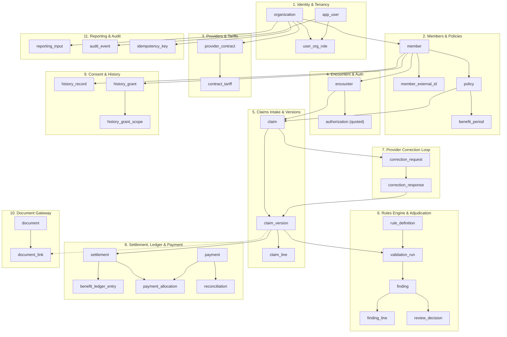

# Claimwise — Master Artifacts Index

**Document Owner:** Silas (Documentation & Presentation Lead)  
**Date:** 2026-10-12  
**Version:** 0.1  
**Project Baseline:** 1-Week Demonstration Build, Synthetic Data Only  
**Technical Stack:** Next.js + TypeScript (Frontend), FastAPI + PostgreSQL 16+ (Backend), Keycloak (Identity)  
**Status:** PROPOSED / UNDER REVIEW (Pending D03 & D05 Sign-off)

---

## 1. Executive Summary

This document serves as the master technical index and requirements traceability register for all engineering, schema, and API contract artifacts pushed to the `insure_health` repository. 

Following the delivery of the initial production database schema and frozen API contract by Tristan/Brian (Backend Contributor), this index establishes complete bidirectional traceability between:
1. **Source Code Artifacts:** DDL SQL, OpenAPI specifications, payload examples, and seed fixtures.
2. **Requirements Specifications:** Business Requirements ([BRD.md](file:///d:/PLP/Claimwise_Telis_Tech/insure_health/docs/BRD.md), [requirements.json](file:///d:/PLP/Claimwise_Telis_Tech/insure_health/docs/requirements.json)) and Software Requirements ([SRS.md](file:///d:/PLP/Claimwise_Telis_Tech/insure_health/docs/SRS.md)).
3. **Architecture Decisions:** Decision log entries and dependencies ([DECISION_LOG.md](file:///d:/PLP/Claimwise_Telis_Tech/insure_health/docs/DECISION_LOG.md), [decisions.json](file:///d:/PLP/Claimwise_Telis_Tech/insure_health/docs/decisions.json)).
4. **Work Backlog:** Seven-day sequence tasks ([WORK_PLAN.md](file:///d:/PLP/Claimwise_Telis_Tech/insure_health/docs/WORK_PLAN.md), [backlog.json](file:///d:/PLP/Claimwise_Telis_Tech/insure_health/docs/backlog.json)).
5. **Acceptance Criteria:** Verifiable test scenarios AT01 through AT14 ([acceptance_tests.json](file:///d:/PLP/Claimwise_Telis_Tech/insure_health/docs/acceptance_tests.json)).

---

## 2. Master Artifact Registry

| # | Artifact Path | Type | Owner | Date Added | Version / Status | Description |
|---|---|---|---|---|---|---|
| 1 | [`db/schema/001_initial.sql`](file:///d:/PLP/Claimwise_Telis_Tech/insure_health/db/schema/001_initial.sql) | PostgreSQL DDL | Tristan/Brian | 2026-10-10 | v0.1 (PROPOSED) | Production DDL containing 34 relational tables, 20 custom enum types, row-version triggers, indexes, and constraints. |
| 2 | [`docs/erd.md`](file:///d:/PLP/Claimwise_Telis_Tech/insure_health/docs/erd.md) | Architecture Doc | Tristan/Brian | 2026-10-10 | v0.1 (PROPOSED) | Entity-Relationship Diagram (Mermaid), domain grouping, enum catalogue, design rationale, and pilot table inventory. |
| 3 | [`contracts/openapi.yaml`](file:///d:/PLP/Claimwise_Telis_Tech/insure_health/contracts/openapi.yaml) | API Specification | Tristan/Brian | 2026-10-10 | v0.1 (FROZEN) | OpenAPI 3.1.0 contract defining 16 REST endpoints, Bearer JWT security scheme, Money minor units, and domain schemas. |
| 4 | [`contracts/README.md`](file:///d:/PLP/Claimwise_Telis_Tech/insure_health/contracts/README.md) | Contract Guide | Tristan/Brian | 2026-10-10 | v0.1 (ACTIVE) | Usage rules for the frozen contract, currency convention (`amount_minor` in KES), idempotency, and versioning rules. |
| 5 | [`contracts/examples/case-001-request.json`](file:///d:/PLP/Claimwise_Telis_Tech/insure_health/contracts/examples/case-001-request.json) | JSON Payload | Tristan/Brian | 2026-10-10 | v0.1 (VERIFIED) | Case 001 draft intake submission payload with 6 service lines totaling KES 36,100.00 (`3,610,000` minor units). |
| 6 | [`contracts/examples/case-001-response.json`](file:///d:/PLP/Claimwise_Telis_Tech/insure_health/contracts/examples/case-001-response.json) | JSON Payload | Tristan/Brian | 2026-10-10 | v0.1 (VERIFIED) | Case 001 validation findings (4 findings, KES 6,400 correction) and settlement preview matching reference arithmetic. |
| 7 | [`fixtures/reference_case_001.json`](file:///d:/PLP/Claimwise_Telis_Tech/insure_health/fixtures/reference_case_001.json) | Seed Fixture | Team | 2026-10-10 | v0.1 (FROZEN) | Canonical synthetic reference case for member, policy, encounter, diagnosis, and billed items. Unknown fields remain null. |
| 8 | [`fixtures/finance_inputs.template.json`](file:///d:/PLP/Claimwise_Telis_Tech/insure_health/fixtures/finance_inputs.template.json) | Fixture Template | Team | 2026-10-10 | v0.1 (BLOCKED) | Template for loss ratio and financial metrics. Deliberately blocked/null pending decision D08. |
| 9 | [`fixtures/history.template.json`](file:///d:/PLP/Claimwise_Telis_Tech/insure_health/fixtures/history.template.json) | Fixture Template | Team | 2026-10-10 | v0.1 (BLOCKED) | Template for longitudinal medical history. Deliberately blocked/null pending decision D07. |

---

## 3. Database Schema Index (`db/schema/001_initial.sql` & `docs/erd.md`)

The schema establishes a multi-tenant relational model designed for PostgreSQL 16+. It consists of **34 tables** across **11 functional domains** and **20 enum types**.

### 3.1 Domain & Table Breakdown

| Domain | Table Name | Purpose | Key Columns / Constraints | Expected Pilot Rows |
|---|---|---|---|---|
| **1. Identity & Tenancy** | `organization` | Tenant entity (Insurer, Provider, TPA, Regulator) | `id` (UUID), `org_type` (`org_type_enum`), `status`, `kra_pin` | ~10 |
| | `app_user` | User identities | `id` (UUID), `email` (`CITEXT` UNIQUE), `status` | ~50 |
| | `user_org_role` | Tenant role assignment | `user_id`, `org_id`, `role` (`role_enum`) | ~80 |
| **2. Members & Policies** | `member` | Covered lives | `id` (UUID), `org_id` (Insurer), `national_id_hash` (SHA-256) | ~5,000 |
| | `member_external_id` | Member identifiers in provider/external systems | `member_id`, `id_type`, `id_value` | ~6,000 |
| | `policy` | Insurance policy contract | `id` (UUID), `member_id`, `policy_number`, `effective_from`, `effective_to` | ~5,000 |
| | `benefit_period` | Annual or period benefit boundaries | `policy_id`, `benefit_type`, `limit_minor`, `used_minor`, `reserved_minor` | ~5,000 |
| **3. Providers & Contracts** | `provider_contract` | Insurer-Provider agreement | `insurer_org_id`, `provider_org_id`, `contract_code`, `effective_dates` | ~50 |
| | `contract_tariff` | Agreed fee schedules & ceilings | `contract_id`, `service_code`, `agreed_rate_minor`, `is_excluded` | ~5,000 |
| **4. Encounters & Pre-auth** | `encounter` | Clinical visit context | `member_id`, `provider_org_id`, `service_date`, `notes_encrypted` | ~20,000 |
| | `"authorization"` | Pre-authorization records *(Quoted identifier)* | `encounter_id`, `auth_code`, `ceiling_minor`, `status` | ~15,000 |
| **5. Claims Intake & Versions** | `claim` | Persistent claim wrapper | `claim_number`, `current_version_id`, `status` (`claim_status_enum`) | ~20,000 |
| | `claim_version` | Immutable submitted claim state | `claim_id`, `version_number`, `source` (`claim_version_source_enum`), `is_immutable` | ~25,000 |
| | `claim_line` | Individual bill line item | `claim_version_id`, `line_number`, `service_code`, `billed_minor` | ~200,000 |
| **6. Supporting Documents** | `document` | Uploaded file metadata | `id` (UUID), `sha256_hash`, `file_size_bytes`, `storage_path` | ~30,000 |
| | `document_link` | Links documents to claims/settlements | `document_id`, `claim_version_id`, `link_type` (`document_link_type_enum`) | ~40,000 |
| **7. Rules Engine & Adjudication** | `rule_definition` | Adjudication rules catalogue | `rule_code`, `rule_type` (`rule_type_enum`), `version`, `is_active` | ~50 |
| | `validation_run` | Evaluation execution record | `claim_version_id`, `total_billed_minor`, `total_correction_minor`, `total_eligible_minor` | ~25,000 |
| | `finding` | Rule evaluation discrepancy | `validation_run_id`, `finding_code`, `severity` (`finding_severity_enum`), `status` | ~100,000 |
| | `finding_line` | Discrepancy line link | `finding_id`, `claim_line_id`, `correction_minor` | ~150,000 |
| | `review_decision` | Adjudicator finding action | `finding_id`, `reviewer_user_id`, `decision` (`review_decision_enum`), `reason` | ~80,000 |
| **8. Provider Correction Loop** | `correction_request` | Reviewer correction notice to provider | `claim_id`, `based_on_version_id`, `requested_lines`, `reason` | ~8,000 |
| | `correction_response` | Provider response / dispute | `correction_request_id`, `response_type` (`correction_response_enum`), `notes` | ~8,000 |
| **9. Settlement & Ledger** | `settlement` | Final adjudicated financial split | `claim_version_id`, `eligible_minor`, `member_share_minor`, `insurer_share_minor` | ~18,000 |
| | `benefit_ledger_entry` | Append-only benefit reservation/spend | `benefit_period_id`, `entry_type` (`ledger_entry_enum`), `amount_minor` | ~40,000 |
| | `payment` | Payment record (Simulated or bank/M-Pesa) | `payment_ref`, `amount_minor`, `method` (`payment_method_enum`) | ~15,000 |
| | `payment_allocation` | Links payment to settlement | `payment_id`, `settlement_id`, `allocated_minor` | ~18,000 |
| | `reconciliation` | Bank/receipt reconciliation | `payment_id`, `matched_minor`, `variance_minor`, `status` (`recon_status_enum`) | ~15,000 |
| **10. History & Consent** | `history_record` | Longitudinal patient clinical event | `member_id`, `encounter_type`, `content_encrypted`, `provenance` | ~10,000 |
| | `history_grant` | Patient consent grant | `member_id`, `recipient_org_id`, `purpose` (`consent_purpose_enum`), `status` | ~5,000 |
| | `history_grant_scope` | Data domain consent filter | `grant_id`, `scope_domain`, `is_allowed` | ~10,000 |
| **11. Infrastructure & Audit** | `reporting_input` | Approved reporting batches | `cohort`, `period_start`, `period_end`, `earned_premium_minor` | ~500 |
| | `audit_event` | Append-only immutable audit log | `id` (`BIGSERIAL`), `actor_id`, `org_id`, `action`, `entity_type`, `entity_id` | ~500,000 |
| | `idempotency_key` | Request mutation deduplication | `org_id`, `idempotency_key`, `request_hash`, `response_payload`, `expires_at` | rolling |

### 3.2 Enum Types Catalogue (20 Types)

1. `org_type_enum`: `INSURER`, `PROVIDER`, `TPA`, `REGULATOR`
2. `org_status_enum`: `ACTIVE`, `SUSPENDED`, `CLOSED`
3. `user_status_enum`: `ACTIVE`, `SUSPENDED`, `LOCKED`, `INVITED`
4. `role_enum`: `INSURER_ADMIN`, `INSURER_REVIEWER`, `INSURER_FINANCE`, `INSURER_UNDERWRITER`, `PROVIDER_ADMIN`, `PROVIDER_BILLER`, `PROVIDER_CLINICIAN`, `TPA_ADMIN`, `TPA_REVIEWER`, `MEMBER`, `AUDITOR`, `SYSTEM`
5. `claim_status_enum`: `DRAFT`, `SUBMITTED`, `VALIDATED`, `UNDER_REVIEW`, `CORRECTION_REQUESTED`, `CORRECTED_SUBMITTED`, `CLARIFICATION`, `APPROVED`, `PAYMENT_PENDING`, `PAID`, `RECONCILED`, `REJECTED`, `APPEALED`, `CANCELLED`
6. `claim_version_source_enum`: `PROVIDER_SUBMITTED`, `PROVIDER_CORRECTED`, `SYSTEM_IMPORT`
7. `finding_severity_enum`: `INFO`, `WARN`, `BLOCK`
8. `finding_status_enum`: `OPEN`, `ACCEPTED`, `DISPUTED`, `OVERRIDDEN`, `RESOLVED`, `WITHDRAWN`
9. `rule_type_enum`: `TARIFF`, `AUTHORIZATION_CEILING`, `EXCLUSION`, `DUPLICATE`, `ANOMALY`, `BENEFIT_LIMIT`, `CLINICAL_APPROPRIATENESS`
10. `review_decision_enum`: `ACCEPT`, `DISPUTE`, `OVERRIDE`, `CLARIFY`
11. `correction_status_enum`: `OPEN`, `ANSWERED`, `ESCALATED`, `WITHDRAWN`
12. `correction_response_enum`: `CORRECTED`, `DISPUTED`, `CLARIFICATION`
13. `settlement_status_enum`: `APPROVED`, `PAYMENT_PENDING`, `PAID`, `RECONCILED`, `REVERSED`
14. `ledger_entry_enum`: `RESERVE`, `CONSUME`, `RELEASE`, `REVERSE`
15. `payment_method_enum`: `SIMULATED`, `BANK`, `MPESA`, `CHEQUE`
16. `recon_status_enum`: `MATCHED`, `PARTIAL`, `UNMATCHED`, `DISPUTED`
17. `consent_purpose_enum`: `CARE`, `UNDERWRITING`, `CLAIMS_REVIEW`
18. `consent_status_enum`: `ACTIVE`, `EXPIRED`, `WITHDRAWN`, `DENIED`
19. `document_source_enum`: `PROVIDER_UPLOAD`, `SCANNED`, `OCR_EXTRACTED`, `SYSTEM`
20. `document_link_type_enum`: `BILL`, `AUTHORIZATION`, `CLINICAL_NOTE`, `RECEIPT`, `DISCHARGE_SUMMARY`

### 3.3 Core Technical Architecture Conventions in Schema

- **Primary Keys:** UUID v4 (`gen_random_uuid()`) on all entity tables; `BIGSERIAL` on `audit_event.id`.
- **Monetary Units:** Never floating point. All money stored as `BIGINT amount_minor` with `CHAR(3) currency = 'KES'`. (e.g. KES 36,100.00 = `3610000`).
- **Timestamps:** Explicit `TIMESTAMPTZ` throughout; defaults to `now()`.
- **Optimistic Locking:** `row_version INT NOT NULL DEFAULT 1` with trigger `touch_row_version()` incrementing on update.
- **Append-Only Immutability:** 
  - `claim_version`: Marked `is_immutable = TRUE` upon submission.
  - `benefit_ledger_entry`: Reversals write new `REVERSE` rows; past records are immutable.
  - `audit_event`: Append-only; triggers block `UPDATE` or `DELETE`.
  - `settlement`: Identity and amounts frozen at insert. Status advances along valid transitions only.
- **Reserved Keyword Handling:** The `authorization` table is defined with double quotes (`"authorization"`) because `AUTHORIZATION` is a PostgreSQL reserved keyword.
- **Extensions:** `CREATE EXTENSION IF NOT EXISTS citext;` used for case-insensitive email matching.
- **Helper Function:** `benefit_available(benefit_period_id UUID)` returns `limit_minor - used_minor - reserved_minor`.

---

## 4. API Contract Index (`contracts/openapi.yaml`)

The API contract is frozen at **v0.1** (OpenAPI 3.1.0) pending cross-team sign-off for D03. It defines **16 core endpoints** supporting the 5-dimension demo walkthrough.

### 4.1 Specification Overview

- **OpenAPI Version:** `3.1.0`
- **Servers:**
  - Local Development: `http://localhost:8000`
  - Demo Environment: `https://api.claimwise.local`
- **Security Scheme:** `bearerAuth` (HTTP Bearer JWT via Keycloak).
- **Global Error Schema:** `Error` containing `code` (string), `message` (string), `details` (array), and `request_id` (UUID).
- **Money Schema:** `{ "amount_minor": integer, "currency": "KES" }`.

### 4.2 Endpoint Catalogue

| Method | Path | Summary & Operation | Auth | Request Body / Parameters | Key Response |
|---|---|---|---|---|---|
| `GET` | `/api/v1/claims` | List claims (tenant-scoped) | Bearer | Query: `status`, `provider_org_id`, `page`, `page_size` | `200 OK` Paginated claims list |
| `POST` | `/api/v1/claims` | Create draft claim | Bearer | JSON: `member_id`, `policy_id`, `provider_org_id`, `encounter_id`, `lines` | `201 Created` Draft claim |
| `GET` | `/api/v1/claims/{id}` | Claim overview & details | Bearer | Path: `id` (UUID) | `200 OK` Full claim overview |
| `PATCH` | `/api/v1/claims/{id}/draft` | Edit draft claim lines | Bearer | Path: `id`, JSON: `lines` | `200 OK` Updated draft (`409` if not in DRAFT) |
| `POST` | `/api/v1/claims/{id}/submit` | Submit claim as immutable version | Bearer | Path: `id` | `200 OK` `ClaimVersion` created |
| `GET` | `/api/v1/claims/{id}/versions` | List all claim versions | Bearer | Path: `id` | `200 OK` Array of `ClaimVersion` |
| `POST` | `/api/v1/claims/{id}/validate` | Run rule assessment engine | Bearer | Path: `id`, JSON: `claim_version_id` | `201 Created` `ValidationRun` |
| `GET` | `/api/v1/claims/{id}/findings` | Read validation findings | Bearer | Path: `id`, Query: `validation_run_id` | `200 OK` Array of `Finding` |
| `POST` | `/api/v1/claims/{id}/correction-requests` | Issue correction request to provider | Bearer | Path: `id`, JSON: `based_on_version_id`, `requested_lines`, `reason` | `201 Created` Correction request |
| `POST` | `/api/v1/claims/{id}/corrections` | Submit provider corrected version | Bearer | Path: `id`, JSON: `correction_request_id`, `lines`, `notes` | `201 Created` New `ClaimVersion` |
| `POST` | `/api/v1/claims/{id}/decisions` | Record reviewer finding decisions | Bearer | Path: `id`, JSON: `decisions` (`finding_id`, `decision`, `reason`, `override_authority`) | `200 OK` Decisions recorded |
| `POST` | `/api/v1/claims/{id}/approve` | Atomic approval & settlement creation | Bearer | Path: `id`, JSON: `claim_version_id` | `200 OK` `Settlement` (`409` if stale/unresolved) |
| `GET` | `/api/v1/claims/{id}/settlement` | Read claim settlement | Bearer | Path: `id` | `200 OK` `Settlement` details |
| `POST` | `/api/v1/payments` | Record simulated payment | Bearer | Header: `Idempotency-Key` (Required) JSON: `settlement_id`, `amount`, `method` | `201 Created` (`409` Idempotency conflict) |
| `POST` | `/api/v1/reconciliations` | Match receipt to settlement | Bearer | JSON: `payment_id`, `settlement_id`, `matched` | `200 OK` Variance & Recon status |
| `GET` | `/api/v1/claims/{id}/audit` | Read claim audit trail | Bearer | Path: `id` | `200 OK` Array of audit events |
| `GET` | `/api/v1/members/{id}/history` | Read permitted medical history | Bearer | Path: `id`, Query: `purpose` (`CARE`, `UNDERWRITING`, `CLAIMS_REVIEW`) | `200 OK` History (`403` if no grant) |
| `POST` | `/api/v1/consent-grants` | Record patient consent grant | Bearer | JSON: `ConsentGrant` | `201 Created` Grant recorded |
| `POST` | `/api/v1/consent-grants/{id}/withdraw` | Withdraw consent grant | Bearer | Path: `id` | `200 OK` Grant withdrawn |
| `GET` | `/api/v1/reports/operations` | Operational queues & metrics | Bearer | Query: `period_start`, `period_end` | `200 OK` Operational metrics |
| `GET` | `/api/v1/reports/loss-ratio` | Loss ratio or unavailable state | Bearer | Query: `cohort`, `period_start`, `period_end` | `200 OK` Loss ratio (or explicit unavailable) |
| `POST` | `/api/v1/documents` | Upload supporting document | Bearer | Multipart Form: `file`, `link_to_claim_version_id`, `link_type` | `201 Created` Uploaded document |
| `GET` | `/api/v1/documents/{id}` | Authorized document download | Bearer | Path: `id` | `200 OK` Stream (`403` if unauthorized) |

### 4.3 Deferred Contract Boundaries (Per Architectural Decisions)

To preserve system truthfulness and prevent fabricated features:
1. **Authentication Endpoints:** Omitted from `openapi.yaml`. Managed externally via Keycloak and Auth.js session handlers per D04.
2. **Rule Configuration & Authoring APIs:** Omitted from v0.1. Deferred pending D05, D06, and D15.
3. **FHIR & OCR Pipelines:** Deferred pending D10.
4. **Reversals & Partial Payments:** Deferred pending D06.

---

## 5. Case 001 Fixture & Arithmetic Reconciliation

Case 001 is the frozen synthetic baseline used to demonstrate end-to-end adjudication, rule enforcement, provider correction, settlement, and financial ledger posting.

### 5.1 Submission Bill Lines (`contracts/examples/case-001-request.json`)

| Line # | Service Code | Description | Qty | Billed Amount (KES) | Contract Tariff / Rule | Adjudication Action |
|---|---|---|---|---|---|---|
| **1** | `CONSULT-OP` | Outpatient Specialist Consultation | 1 | KES 2,500.00 (`250,000`) | Contract rate is KES 2,000.00 | **TARIFF_MISMATCH** (WARN): Rate exceeds tariff by KES 500.00 (`50,000`)* |
| **2** | `LAB-CBC` | Complete Blood Count | 1 | KES 1,800.00 (`180,000`) | Contract rate is KES 1,500.00 | **TARIFF_MISMATCH** (WARN): Rate exceeds tariff by KES 300.00 (`30,000`)* |
| **3** | `IMG-MRI-BRAIN` | MRI brain without contrast | 1 | KES 28,000.00 (`2,800,000`) | Pre-auth `AUTH-001` ceiling KES 25,000.00 | **AUTH_CEILING** (BLOCK): Exceeds authorization ceiling by KES 3,000.00 (`300,000`) |
| **4** | `PHARM-MISC` | Prescribed Medication | 1 | KES 1,200.00 (`120,000`) | Covered service within limit | **PASS**: Eligible in full |
| **5** | `LAB-CBC` | Complete Blood Count (Duplicate) | 1 | KES 1,800.00 (`180,000`) | Same-day repeat lab test | **DUPLICATE_LINE** (BLOCK): Full line rejected, KES 1,800.00 (`180,000`) |
| **6** | `ADMIN-FEE` | Facility Administration Fee | 1 | KES 800.00 (`80,000`) | Excluded in provider contract `CON-2026-017` | **EXCLUDED_LINE** (WARN): Full line excluded, KES 800.00 (`80,000`) |
| **Total** | | | | **KES 36,100.00** (`3,610,000`) | | **Total Corrections: KES 6,400.00** (`640,000`) |

*\*Note on Deduplication (FR13):* In `case-001-response.json`, Lines 1 & 2 are grouped under finding `TARIFF_MISMATCH` with combined proposed correction KES 800.00 (`80,000` minor units). Line 5 (Duplicate CBC) is removed under `DUPLICATE_LINE` and receives no duplicate tariff reduction.

### 5.2 Financial Settlement Reconciliation (`contracts/examples/case-001-response.json`)

The settlement response exactly mirrors the arithmetic required by SRS Section FR17 and Acceptance Test AT01:

$$\text{Total Billed} = \text{KES } 36,100.00 \quad (3,610,000 \text{ minor})$$
$$\text{Total Adjustments / Deductions} = \text{KES } 6,400.00 \quad (640,000 \text{ minor})$$
$$\text{Total Eligible Amount} = 36,100 - 6,400 = \text{KES } 29,700.00 \quad (2,970,000 \text{ minor})$$
$$\text{Member Share (10\% Coinsurance)} = 29,700 \times 0.10 = \text{KES } 2,970.00 \quad (297,000 \text{ minor})$$
$$\text{Insurer Payable Share (90\%)} = 29,700 \times 0.90 = \text{KES } 26,730.00 \quad (2,673,000 \text{ minor})$$

**Benefit Ledger Verification:**
- Initial Policy Annual Outpatient Limit: KES 100,000.00 (`10,000,000`)
- Prior Consumed Outpatient Benefit: KES 18,000.00 (`1,800,000`)
- Case 001 Insurer Share Posted: KES 26,730.00 (`2,673,000`)
- **Remaining Available Benefit:** $100,000 - 18,000 - 26,730 = \mathbf{\text{KES } 55,270.00} \quad (5,527,000 \text{ minor})$
- **Reconciliation Variance:** KES 0.00 (`0` minor) upon exact payment match.

---

## 6. Requirements Traceability Matrix (RTM)

This matrix maps Business Requirements (BR), Functional Requirements (FR), and Non-Functional Requirements (NF) to their corresponding schema tables, API contract endpoints, and acceptance test cases.

| Req ID | Requirement Title | Database Table(s) | OpenAPI Endpoint(s) | Acceptance Test | Implementation Status |
|---|---|---|---|---|---|
| **BR01** | Full Strategy Demonstration | All tables | All endpoints | AT13 | Observable 5-dimension workflow |
| **BR02** | Explainable Claim Corrections | `validation_run`, `finding`, `finding_line` | `POST .../validate`, `GET .../findings` | AT01 | Verified in Case 001 examples |
| **BR03** | Core Stakeholder Representation | `organization`, `user_org_role`, `history_grant` | `/api/v1/claims`, `/api/v1/consent-grants` | AT12 | Modeled in DDL & OpenAPI |
| **BR04** | Supportable Claims & Provenance | `reporting_input`, `history_record` | `/api/v1/reports/loss-ratio` | AT10 | Blocked inputs explicit |
| **BR05** | Reproducible Delivery | All tables & migrations | All endpoints | AT14 | DDL v0.1 & contract v0.1 delivered |
| **FR01** | Capability Truthfulness | `reporting_input`, `history_record` | `/api/v1/reports/*` | AT13 | Truthful labels, mocks disclosed |
| **FR02** | Data Provenance | `claim_version`, `history_record` | All endpoints | AT08, AT10 | Source & version retained |
| **FR03** | Reference Fixture Isolation | `policy`, `contract_tariff` | `/api/v1/claims` | AT08 | Case 001 attached to specific fixture |
| **FR04** | Structured Claim Intake | `claim`, `encounter`, `"authorization"` | `POST /api/v1/claims` | AT01 | Request schema validated |
| **FR05** | Immutable Submission Versions | `claim_version`, `claim_line` | `POST .../submit`, `GET .../versions` | AT01, AT02 | `is_immutable` flag & versioning |
| **FR06** | Preauthorization Evidence | `"authorization"`, `encounter` | `POST /api/v1/claims` | AT01 | `AUTH-001` ceiling enforced |
| **FR07** | Preauthorization Creation | `"authorization"`, `encounter` | Deferred (D02) | — | Schema ready; API deferred |
| **FR08** | Evidence Retrieval Security | `document`, `document_link` | `GET /api/v1/documents/{id}` | AT12 | Access-checked document gateway |
| **FR09** | Extraction Mode / OCR | `document` (`document_source_enum`) | `POST /api/v1/documents` | — | Deferred per D02/D10 |
| **FR10** | Multichannel Intake | `claim_version_source_enum` | `POST /api/v1/claims` | — | Maps to unified schema |
| **FR11** | Versioned Rule Assessment | `validation_run`, `rule_definition` | `POST .../validate` | AT04 | Evaluation run frozen to versions |
| **FR12** | Explainable Findings | `finding`, `finding_line` | `GET .../findings` | AT01 | Code, severity, line, correction |
| **FR13** | Correction Deduplication | `validation_run`, `finding` | `POST .../validate` | AT01 | Deduplicated in Case 001 |
| **FR14** | Human Adjudication Review | `review_decision` | `POST .../decisions` | AT03 | Actor, action & reason logged |
| **FR15** | Provider Correction Loop | `correction_request`, `correction_response` | `POST .../correction-requests`, `.../corrections` | AT02 | Linked versioning cycle |
| **FR16** | Anomaly Explanation | `finding` (`rule_type = 'ANOMALY'`) | `GET .../findings` | AT11 | Deterministic separation |
| **FR17** | Reference Settlement Math | `settlement` | `GET .../settlement` | AT01 | Exact 36100 / 6400 / 29700 / 26730 |
| **FR18** | Policy Configuration Isolation | `policy`, `benefit_period` | `/api/v1/claims/{id}/approve` | AT08 | Non-001 policies require config |
| **FR19** | Benefit Ledger Accounting | `benefit_ledger_entry` | `/api/v1/claims/{id}/approve` | AT05 | Double-spend prevention |
| **FR20** | Atomic Claim Approval | `settlement`, `claim_version`, `audit_event` | `POST .../approve` | AT03, AT04 | Transactional commit in DDL |
| **FR21** | Simulated Payments | `payment`, `payment_allocation` | `POST /api/v1/payments` | AT06 | Labeled `SIMULATED` |
| **FR22** | Receipt Reconciliation | `reconciliation` | `POST /api/v1/reconciliations` | AT07 | Zero variance on exact match |
| **FR23** | Idempotency Protection | `idempotency_key` | `POST /api/v1/payments` | AT06 | Header `Idempotency-Key` checked |
| **FR24** | Purpose-Scoped History Access | `history_record`, `history_grant` | `GET /api/v1/members/{id}/history` | AT09 | Purpose enum enforced |
| **FR25** | Patient Consent Withdrawal | `history_grant`, `history_grant_scope` | `POST .../consent-grants/{id}/withdraw` | AT09 | Status set to `WITHDRAWN` |
| **FR26** | Audit Trail Attributability | `audit_event` | `GET .../audit` | AT12 | Append-only; no clinical text |
| **FR27** | Truthful Loss Ratio Input | `reporting_input` | `GET /api/v1/reports/loss-ratio` | AT10 | Missing inputs report unavailable |
| **FR28** | Segmented Operational Reports | `reporting_input` | `GET /api/v1/reports/operations` | AT10 | Queue & aging metrics |
| **FR29** | Versioned Policy Catalogue | `policy`, `contract_tariff`, `rule_definition` | SRS table / D15 | — | Schema ready; read APIs open |
| **FR30** | Service-Date Version Selection | `claim`, `policy`, `contract_tariff` | `POST .../validate` | — | Effective dates in DDL |
| **NF01** | Server-Enforced Access | `user_org_role` | All endpoints | AT09, AT12 | Bearer JWT + tenant filtering |
| **NF02** | Secrets & Data Discipline | `member.national_id_hash`, encrypted notes | All endpoints | — | No raw national ID or secrets |
| **NF03** | Immutability & Audit | `audit_event`, `claim_version` | All endpoints | — | Immutable submissions & ledger |
| **NF04** | Honest User Feedback States | Frontend Error Handling | All endpoints | AT13 | No fabricated success toasts |
| **NF05** | Reproducible Delivery | `001_initial.sql`, `openapi.yaml` | All endpoints | AT14 | DDL script & OpenAPI spec |
| **NF06** | Performance & Recovery | Table indexes & constraints | All endpoints | — | Pilot row sizing documented |

---

## 7. Decisions & Tasks Dependency Mapping

### 7.1 Key Decision Dependencies

| Decision | Subject | Status | Impact on Artifacts |
|---|---|---|---|
| **D03** | Technical conventions and API freeze | **OPEN** | Tristan/Brian provided `openapi.yaml` and `001_initial.sql`. Lameck approved frontend direction. Cross-team sign-off pending. |
| **D05** | Data schema & fixture extension | **OPEN** | Tristan/Brian provided DDL schema and Case 001 examples. Service-date selection confirmed by Lameck. Field coding sign-off pending. |
| **D04** | Identity and Access Control | **OPEN** | Keycloak selected. Role enum defined in DDL (`role_enum`). Server-side API enforcement pending backend implementation (T06). |
| **D06** | Financial Policy & Exceptions | **OPEN** | Settlement and ledger tables defined in DDL. Case 001 formulas isolated. General policy math pending. |
| **D07** | Patient History & Consent | **OPEN** | DDL includes `history_record` & `history_grant`. Templates in fixtures remain null until team confirms synthetic records. |
| **D08** | Reporting & Loss Ratio Inputs | **OPEN** | DDL includes `reporting_input`. Finance template remains null until team approves premium/reserve inputs. |
| **D10** | Document Storage & FHIR | **OPEN** | `document` and `document_link` tables created. Cloud storage integration deferred. |
| **D15** | Policy/Rule Authoring & Publishing | **OPEN** | Guardrails agreed (separation of duties). Publishing APIs deferred from v0.1 contract. |

### 7.2 Backlog Task Alignment

| Task ID | Owner | Title | Artifact Relationship | Current Status |
|---|---|---|---|---|
| **T02** | Tristan/Brian | Prepare ERD workflow and reference rules | Produced [`docs/erd.md`](file:///d:/PLP/Claimwise_Telis_Tech/insure_health/docs/erd.md) and [`db/schema/001_initial.sql`](file:///d:/PLP/Claimwise_Telis_Tech/insure_health/db/schema/001_initial.sql). | **DELIVERED FOR REVIEW** |
| **T03** | Tristan/Brian | Freeze shared API contract with frontend owners | Produced [`contracts/openapi.yaml`](file:///d:/PLP/Claimwise_Telis_Tech/insure_health/contracts/openapi.yaml) and [`contracts/examples/`](file:///d:/PLP/Claimwise_Telis_Tech/insure_health/contracts/examples/). | **DELIVERED FOR REVIEW** |
| **T04** | Obunde | Setup backend database migrations & environment | Consumes `001_initial.sql` to author SQLAlchemy models & Alembic migration `0002_schema`. | READY TO PROCEED |
| **T05** | Lameck | Setup Next.js shell and shared API client | Consumes `contracts/openapi.yaml` to type TypeScript API clients. | IN PROGRESS |
| **T07** | Tristan/Brian | Implement policy/contract seed & Case 001 | Consumes `fixtures/reference_case_001.json` and `001_initial.sql`. | UNBLOCKED |
| **T09** | Ingrid | Build intake claim detail and auth views | Consumes endpoints `/api/v1/claims` and `case-001-request.json`. | UNBLOCKED |
| **T10** | Lameck | Build dashboard queue and claim navigation | Consumes endpoint `GET /api/v1/claims`. | UNBLOCKED |
| **T11** | Tristan/Brian | Implement versioned rule assessment | Implements `POST /api/v1/claims/{id}/validate` matching `case-001-response.json`. | UNBLOCKED |
| **T12** | Lameck | Build validation and reviewer workbench | Consumes `GET /api/v1/claims/{id}/findings` and `POST .../decisions`. | UNBLOCKED |
| **T14** | Ingrid | Build provider correction views | Consumes `/api/v1/claims/{id}/correction-requests` and `.../corrections`. | UNBLOCKED |
| **T15** | Obunde | Implement settlement & ledger | Implements `/api/v1/claims/{id}/approve` and `/api/v1/payments`. | UNBLOCKED |
| **T16** | Lameck | Build settlement and payment views | Consumes `GET .../settlement` and `POST /api/v1/payments`. | UNBLOCKED |
| **T23** | Silas | Maintain BRD/SRS/register & index artifacts | Author of this master index; tracks decision dependencies and change log. | **ACTIVE (INDEXED)** |

---

## 8. Review Notes & Open Questions for Team Sign-Off

As Documentation Lead, Silas highlights the following specific checkpoints for the team:

### 8.1 For Frontend Owners (Ingrid & Lameck)
1. **Money Representation:** Verify that all frontend components handle money exclusively as integer minor units (`amount_minor: integer, currency: "KES"`). Confirm that dividing by 100 for display occurs only at presentation boundaries.
2. **Draft Submission Schema:** Verify that `contracts/examples/case-001-request.json` matches the input fields of the intake form.
3. **Findings & Adjudication:** Confirm that the 4 findings in `case-001-response.json` (severity, message, affected lines, proposed correction) cleanly bind to the reviewer workbench UI.

### 8.2 For Backend Owners (Tristan/Brian & Obunde)
1. **PostgreSQL Reserved Keyword:** Note that `"authorization"` is quoted in DDL. In SQLAlchemy models, ensure `__tablename__ = "authorization"` handles table name quoting correctly.
2. **Alembic Migration Strategy:** As documented, `db/schema/001_initial.sql` is a review DDL script. Alembic baseline revision `0001_baseline.py` remains empty until SQLAlchemy models are created and migration `0002_initial_schema` is generated.
3. **Missing Read Endpoints in OpenAPI v0.1:** The SRS table (lines 277–281) proposes read-only endpoints for policy catalogue (`GET /api/v1/policies/{id}/versions`, `GET /api/v1/policies/{id}/rules`, etc.). These are currently omitted from `openapi.yaml`. If required for the frontend catalogue tab, coordinate whether to append them in v0.2 or keep them mocked in the UI.

### 8.3 For Documentation & Delivery (Silas)
1. Maintain this index as the authoritative map for all subsequent code changes.
2. Track acceptance test execution evidence against AT01 through AT14 once the backend service starts running.
