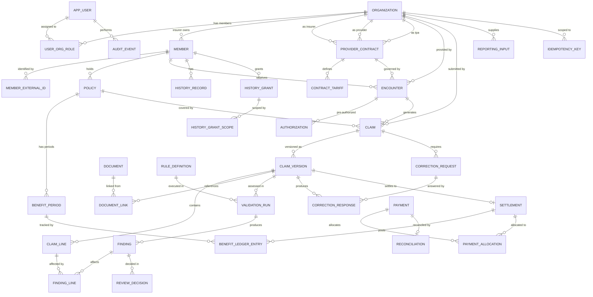

# Claimwise — ERD v0.1

**Status:** proposed schema for D03 and D05 review. Not signed off.  
**Database:** PostgreSQL 16+  
**DDL:** [`db/schema/001_initial.sql`](../db/schema/001_initial.sql)

Alembic stays on the empty `0001_baseline` revision until this schema is approved and SQLAlchemy models exist. Running the SQL file is a review check. It is not the application migration.

**Conventions:** `snake_case`, UUID v4 primary keys, `TIMESTAMPTZ` for all times, money as `BIGINT` minor units plus `CHAR(3)` currency, soft delete via `deleted_at` where historical retention matters, optimistic locking via `row_version`.

## Diagram

`AUTHORIZATION` is the table `"authorization"`. The name is quoted because `AUTHORIZATION` is a reserved keyword in PostgreSQL.

## Domains

| Domain | Tables |
| --- | --- |
| Identity and tenancy | `organization`, `app_user`, `user_org_role` |
| Members, policies, benefits | `member`, `member_external_id`, `policy`, `benefit_period` |
| Providers and contracts | `provider_contract`, `contract_tariff` |
| Encounters and authorizations | `encounter`, `"authorization"` |
| Claims | `claim`, `claim_version`, `claim_line` |
| Documents | `document`, `document_link` |
| Rules and validation | `rule_definition`, `validation_run`, `finding`, `finding_line`, `review_decision` |
| Correction loop | `correction_request`, `correction_response` |
| Settlement and payment | `settlement`, `benefit_ledger_entry`, `payment`, `payment_allocation`, `reconciliation` |
| Consent and history | `history_record`, `history_grant`, `history_grant_scope` |
| Reporting and audit | `reporting_input`, `audit_event`, `idempotency_key` |

34 tables.

## Enum types

| Type | Values |
| --- | --- |
| `org_type_enum` | `INSURER`, `PROVIDER`, `TPA`, `REGULATOR` |
| `org_status_enum` | `ACTIVE`, `SUSPENDED`, `CLOSED` |
| `user_status_enum` | `ACTIVE`, `SUSPENDED`, `LOCKED`, `INVITED` |
| `role_enum` | `INSURER_ADMIN`, `INSURER_REVIEWER`, `INSURER_FINANCE`, `INSURER_UNDERWRITER`, `PROVIDER_ADMIN`, `PROVIDER_BILLER`, `PROVIDER_CLINICIAN`, `TPA_ADMIN`, `TPA_REVIEWER`, `MEMBER`, `AUDITOR`, `SYSTEM` |
| `claim_status_enum` | `DRAFT`, `SUBMITTED`, `VALIDATED`, `UNDER_REVIEW`, `CORRECTION_REQUESTED`, `CORRECTED_SUBMITTED`, `CLARIFICATION`, `APPROVED`, `PAYMENT_PENDING`, `PAID`, `RECONCILED`, `REJECTED`, `APPEALED`, `CANCELLED` |
| `claim_version_source_enum` | `PROVIDER_SUBMITTED`, `PROVIDER_CORRECTED`, `SYSTEM_IMPORT` |
| `finding_severity_enum` | `INFO`, `WARN`, `BLOCK` |
| `finding_status_enum` | `OPEN`, `ACCEPTED`, `DISPUTED`, `OVERRIDDEN`, `RESOLVED`, `WITHDRAWN` |
| `rule_type_enum` | `TARIFF`, `AUTHORIZATION_CEILING`, `EXCLUSION`, `DUPLICATE`, `ANOMALY`, `BENEFIT_LIMIT`, `CLINICAL_APPROPRIATENESS` |
| `review_decision_enum` | `ACCEPT`, `DISPUTE`, `OVERRIDE`, `CLARIFY` |
| `correction_status_enum` | `OPEN`, `ANSWERED`, `ESCALATED`, `WITHDRAWN` |
| `correction_response_enum` | `CORRECTED`, `DISPUTED`, `CLARIFICATION` |
| `settlement_status_enum` | `APPROVED`, `PAYMENT_PENDING`, `PAID`, `RECONCILED`, `REVERSED` |
| `ledger_entry_enum` | `RESERVE`, `CONSUME`, `RELEASE`, `REVERSE` |
| `payment_method_enum` | `SIMULATED`, `BANK`, `MPESA`, `CHEQUE` |
| `recon_status_enum` | `MATCHED`, `PARTIAL`, `UNMATCHED`, `DISPUTED` |
| `consent_purpose_enum` | `CARE`, `UNDERWRITING`, `CLAIMS_REVIEW` |
| `consent_status_enum` | `ACTIVE`, `EXPIRED`, `WITHDRAWN`, `DENIED` |
| `document_source_enum` | `PROVIDER_UPLOAD`, `SCANNED`, `OCR_EXTRACTED`, `SYSTEM` |
| `document_link_type_enum` | `BILL`, `AUTHORIZATION`, `CLINICAL_NOTE`, `RECEIPT`, `DISCHARGE_SUMMARY` |

Member, policy, contract, encounter, and authorization statuses are `TEXT` checks in this version, not enum types.

## Design decisions in this draft

| Decision | Value |
| --- | --- |
| Primary keys | UUID v4 via `gen_random_uuid()`, except `audit_event.id` (`BIGSERIAL`) |
| Timestamps | `TIMESTAMPTZ` |
| Money | `BIGINT` minor units and `CHAR(3)` currency |
| Soft delete | `deleted_at` on long-lived entities |
| Optimistic locking | `row_version` on mutable entities, incremented by trigger |
| Audit | Append-only `audit_event`. No clinical text in the payload |
| Ledger | Append-only `benefit_ledger_entry`. Reversals are new `REVERSE` rows |
| Claim versions | Immutable once `is_immutable` and `submitted_at` are set |
| Settlements | One per claim version. Identity and amounts frozen at insert. Status may advance until `RECONCILED` or `REVERSED` |
| Tenancy | `organization` is the tenant. Insurer, provider, and TPA are organization roles on a contract |
| Consent | `history_grant` plus `history_grant_scope` |
| Idempotency | `idempotency_key`, 24-hour default expiry |
| National ID | `member.national_id_hash` only. Raw identifier is not stored |
| Clinical notes | `encounter.notes_encrypted` and `history_record.content_encrypted` |

These choices are proposed. D03 (conventions and contract) and D05 (schema and fixtures) are still open. Case 001 financial values attach to that policy only. They are not universal calculation rules.

## Table inventory

| # | Table | Domain | Rows expected (pilot) |
| --- | --- | --- | --- |
| 1 | `organization` | Identity | ~10 |
| 2 | `app_user` | Identity | ~50 |
| 3 | `user_org_role` | Identity | ~80 |
| 4 | `member` | Members | ~5,000 |
| 5 | `member_external_id` | Members | ~6,000 |
| 6 | `policy` | Members | ~5,000 |
| 7 | `benefit_period` | Members | ~5,000 |
| 8 | `provider_contract` | Providers | ~50 |
| 9 | `contract_tariff` | Providers | ~5,000 |
| 10 | `encounter` | Encounters | ~20,000 |
| 11 | `"authorization"` | Encounters | ~15,000 |
| 12 | `claim` | Claims | ~20,000 |
| 13 | `claim_version` | Claims | ~25,000 |
| 14 | `claim_line` | Claims | ~200,000 |
| 15 | `document` | Documents | ~30,000 |
| 16 | `document_link` | Documents | ~40,000 |
| 17 | `rule_definition` | Rules | ~50 |
| 18 | `validation_run` | Validation | ~25,000 |
| 19 | `finding` | Validation | ~100,000 |
| 20 | `finding_line` | Validation | ~150,000 |
| 21 | `review_decision` | Validation | ~80,000 |
| 22 | `correction_request` | Corrections | ~8,000 |
| 23 | `correction_response` | Corrections | ~8,000 |
| 24 | `settlement` | Financial | ~18,000 |
| 25 | `benefit_ledger_entry` | Financial | ~40,000 |
| 26 | `payment` | Financial | ~15,000 |
| 27 | `payment_allocation` | Financial | ~18,000 |
| 28 | `reconciliation` | Financial | ~15,000 |
| 29 | `history_record` | History | ~10,000 |
| 30 | `history_grant` | History | ~5,000 |
| 31 | `history_grant_scope` | History | ~10,000 |
| 32 | `reporting_input` | Reporting | ~500 |
| 33 | `audit_event` | Audit | ~500,000 |
| 34 | `idempotency_key` | Infrastructure | rolling |

## DDL notes for reviewers

- `citext` is created for `app_user.email`.
- `document_link.settlement_id` has a foreign key to `settlement`. The draft left that column unconstrained because `settlement` is created later.
- `encounter` does not have `updated_at`. Its trigger only increments `row_version`.
- `claim.current_version_id` is a foreign key added after `claim_version` exists. Insert the claim first with a null version, then point it at the version.
- `benefit_available(benefit_period_id)` returns `limit_minor - used_minor - reserved_minor`.
- Pilot row counts are capacity sketches, not fixture commitments.
